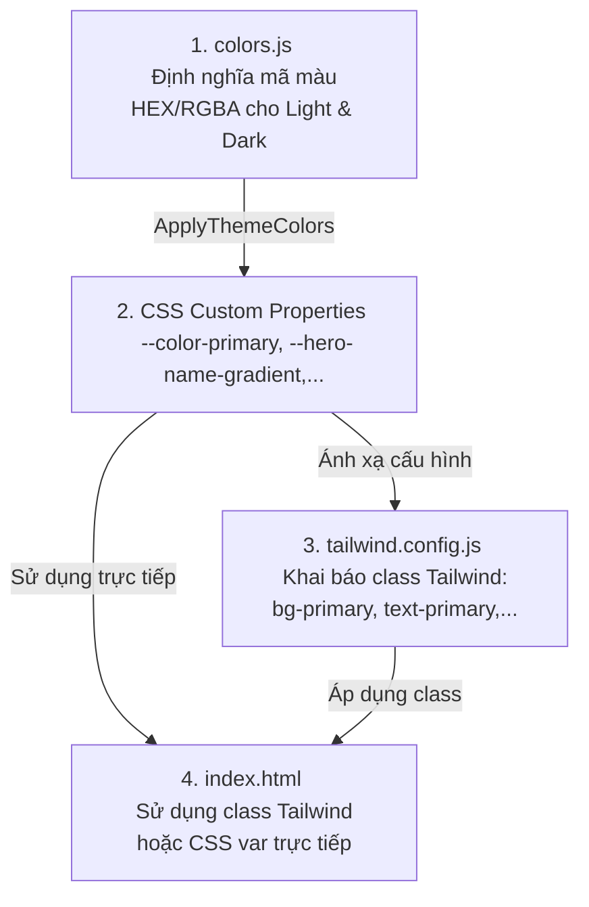

# Hướng Dẫn Sử Dụng và Cấu Hình Màu Sắc (Wedding Page)

Tài liệu này chi tiết hóa cách các biến màu sắc trong [colors.js](colors.js) được ánh xạ sang cấu hình Tailwind CSS trong [tailwind.config.js](tailwind.config.js) và được áp dụng thực tế trên trang giao diện [index.html](index.html).

---

## 💡 Cách hoạt động của hệ thống màu sắc



* **Chỉnh sửa màu**: Bạn chỉ cần chỉnh sửa mã màu Hex/RGBA trong đối tượng `THEME_PALETTES` của file [colors.js](colors.js).
* **Biên dịch lại CSS**: Sau khi thay đổi hoặc thêm token màu mới, hãy chạy lệnh dưới đây trong Terminal để biên dịch lại file CSS:
  ```bash
  npm run build:css
  ```

---

## 🎨 Chi tiết các nhóm màu & Nơi sử dụng

### 1. Bảng màu chủ đạo (Theme Palette Colors) — Bản thiết kế đã duyệt

Được cấu hình thông qua Tailwind CSS và áp dụng rộng rãi bằng các class như `bg-{color}`, `text-{color}`, `border-{color}`.

• **Light Mode**: Trắng ngà (`#F5F0EB`) – Đỏ rượu vang (`#762D40`).
• **Dark Mode**: Cacao ấm (`#30221D`) – Champagne (`#F1D5AB` / `#F3D9AF`).

| Tên biến CSS | Mã màu (Light / Dark) | Vai trò & Nơi sử dụng trong Web |
| :--- | :--- | :--- |
| **`primary`**<br>`--color-primary` | `#762D40` / `#F1D5AB` | **Màu nhấn chủ đạo (Đỏ rượu vang / Champagne lì):**<br>• Tên cô dâu & chú rể, nhãn phụ đề (Overline caps).<br>• Nền nút bấm chính (`.ob-cta-button`, Xác nhận RSVP, Mở lời mời, Gửi phản hồi).<br>• Biểu tượng nhấn (trái tim, nhẫn cưới, kim cương).<br>• Chấm tiến trình hiện tại. |
| **`primary-hover`**<br>`--color-primary-hover` | `#602235` / `#F7E2C3` | **Trạng thái hover nút chính:**<br>• Nền nút chính khi hover/focus. |
| **`on-primary`**<br>`--color-on-primary` | `#FFFFFF` / `#39271E` | **Màu chữ nút chính:**<br>• Trắng tinh khôi trên nền đỏ rượu (Light) và nâu cacao trầm trên nền champagne (Dark), đạt chuẩn tương phản cao WCAG AA/AAA. |
| **`secondary`**<br>`--color-secondary` | `#DED0BF` / `#B69B7B` | **Viền & đường trang trí (Champagne ấm lì, mảnh 1px):**<br>• Viền khung thẻ thiệp, đường kẻ phân cách, viền nút phụ. |
| **`tertiary`**<br>`--color-tertiary` | `#602235` / `#E6C595` | **Màu nhấn phụ / Hover:**<br>• Trạng thái tương tác, cảnh báo lỗi form nhẹ nhàng. |
| **`background`**<br>`--color-background` | `#F5F0EB` / `#30221D` | **Nền trang chính:**<br>• Light: Trắng ngà sạch, không ám vàng xanh.<br>• Dark: Nâu cacao ấm, có thể kết hợp radial gradient dịu nhẹ ánh đèn nến tiệc cưới. |
| **`surface`**<br>`--color-surface` | `#FAF5EF` / `#3D2C25` | **Nền bề mặt phụ:**<br>• Lớp nền phụ cho các section lót. |
| **`surfaceLowest`**<br>`--color-surface-lowest` | `#EFEAE3` / `#241814` | **Nền bề mặt sâu:**<br>• Lớp nền chuyển tiếp. |
| **`onBackground`**<br>`--color-on-background` | `#392D31` / `#FFF6E8` | **Chữ chính, tiêu đề (WCAG AAA):**<br>• Chữ tiêu đề lớn, nội dung chính trên trang và trên thẻ thiệp. |
| **`onSurface`**<br>`--color-on-surface` | `#392D31` / `#FFF6E8` | **Chữ trên các hộp nội dung & thẻ.** |
| **`onSurfaceVariant`**<br>`--color-on-surface-variant` | `#705E61` / `#E8D9CA` | **Chữ phụ:**<br>• Lời dẫn, chú thích ngày giờ, địa chỉ, bản quyền. |
| **`outline`**<br>`--color-outline` | `#DED0BF` / `#B69B7B` | **Viền và đường trang trí mảnh 1px:**<br>• Khung viền tấm thiệp, đường chỉ trang trí. |
| **`outlineVariant`**<br>`--color-outline-variant` | `#E8DFD3` / `#523F36` | **Viền mờ phụ.** |
| **`surfaceContainer`**<br>`--color-surface-container` | `#F7F2EC` / `#49372F` | **Hộp chứa nội dung / Trường nhập liệu Dark:**<br>• Nền các khối bên trong thiệp. |
| **`card`**<br>`--color-card` | `#FFFCF8` / `#695247` | **Nền tấm thiệp:**<br>• Light: Trắng ngà tinh khôi `#FFFCF8`.<br>• Dark: Nâu taupe ấm `#695247` (sáng hơn nền cacao `#30221D` rõ ràng, tạo chiều sâu thị giác). |
| **`input-bg`**<br>`--input-bg` | `#FFFFFF` / `#49372F` | **Nền trường nhập liệu:**<br>• Ô input, textarea, dropdown. |
| **`input-border`**<br>`--input-border` | `#CDBDB4` / `#B69B7B` | **Viền trường nhập liệu.** |

---

### 2. Màu sắc thành phần đặc biệt (Component-Specific Custom Colors)

Được áp dụng trực tiếp qua các biến CSS (CSS Variables) trong phần thẻ `<style>` của [index.html](index.html).

#### A. Khu vực Màn hình mở đầu (Hero Section - `#home`)
* **`hero.nameGradient`** (`--hero-name-gradient`):
  * *Light:* Gradient hồng nhạt ngọt ngào.
  * *Dark:* Gradient kim loại bạc sang trọng.
  * *Sử dụng:* Làm màu chữ nghệ thuật cho tên cô dâu & chú rể lớn ở giữa màn hình.
* **`hero.nameGlow`** (`--hero-name-glow`):
  * *Light:* Hiệu ứng đổ bóng phát sáng hồng hồng.
  * *Dark:* Đổ bóng sâu màu tối kết hợp ánh hồng mờ.
  * *Sử dụng:* Giúp chữ tên cô dâu/chú rể nổi bật rõ ràng trên các hình nền slideshow.
* **`hero.ampersand`** (`--hero-ampersand`):
  * *Sử dụng:* Màu của ký tự kết nối `&` giữa hai tên.
* **`hero.ampersandGlow`** (`--hero-ampersand-glow`):
  * *Sử dụng:* Tạo độ phát sáng lấp lánh cho ký tự `&`.
* **`hero.dateText`** (`--hero-date-text`):
  * *Sử dụng:* Màu của ngày tháng cưới hiển thị dưới tên.
* **`hero.halo`** (`--hero-halo`):
  * *Sử dụng:* Vùng hào quang mờ hình tròn (radial gradient) phía sau tên giúp tăng độ tương phản với hình nền.
* **`hero.divider`** (`--hero-divider`):
  * *Sử dụng:* Đường kẻ ngang gradient trang trí dưới tên.
* **`hero.dividerGlow`** (`--hero-divider-glow`):
  * *Sử dụng:* Tạo hiệu ứng ánh kim phát sáng cho đường kẻ ngang.

#### B. Hiệu ứng Cánh hoa rơi (Falling Petals - `#petals`)
* **`petals`** (Mảng màu):
  * *Light:* `['#F2E2D8', '#E6CEC0', '#D4B2A0']` (Cánh hoa mềm màu Champagne Cashmere).
  * *Dark:* `['#DFC19D', '#6E5340', '#4A372B']` (Cánh hoa vàng đồng ánh kim xen kẽ nâu Espresso).
  * *Sử dụng:* Script JS sẽ tự động lấy ngẫu nhiên các màu này để gán cho các cánh hoa rơi tự do trên màn hình.

#### C. Các hiệu ứng giao diện khác
* **`sectionDivider`** (`--section-divider`):
  * *Sử dụng:* Đường phân cách mờ biến mất dần ở 2 đầu nằm giữa các phần nội dung chính trên trang.
* **`musicPulse`** (`--music-pulse`):
  * *Sử dụng:* Vòng tròn sóng phát sáng tỏa ra xung quanh nút bật/tắt Nhạc nền khi đang phát nhạc.
* **`form.error`** (`--form-error`):
  * *Sử dụng:* Màu chữ hiển thị thông báo lỗi khi gửi RSVP hoặc Lời chúc thất bại.
* **`form.success`** (`--form-success`):
  * *Sử dụng:* Màu chữ hiển thị thông báo thành công khi gửi RSVP hoặc Lời chúc thành công.
* **`glass.background`** (`--glass-bg`) & **`glass.border`** (`--glass-border`):
  * *Sử dụng:* Tạo hiệu ứng kính mờ (Glassmorphism) cực kỳ sang trọng cho các nút bấm điều hướng nổi (Nút nhạc, Nút đổi giao diện sáng/tối, Nút Menu, Nút cuộn lên đầu trang).
